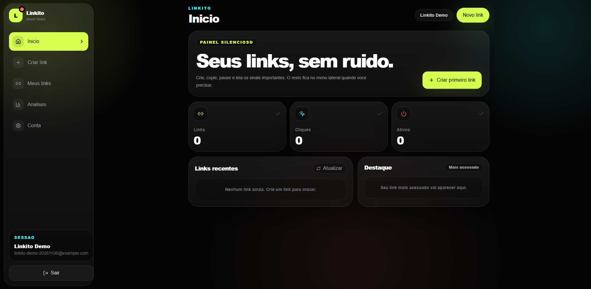
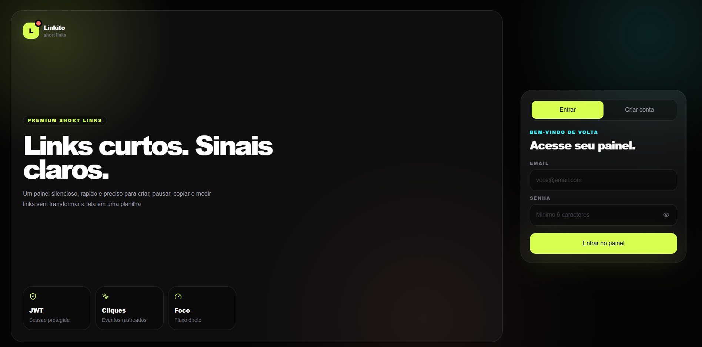
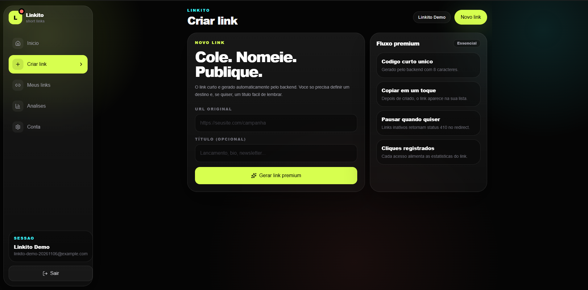
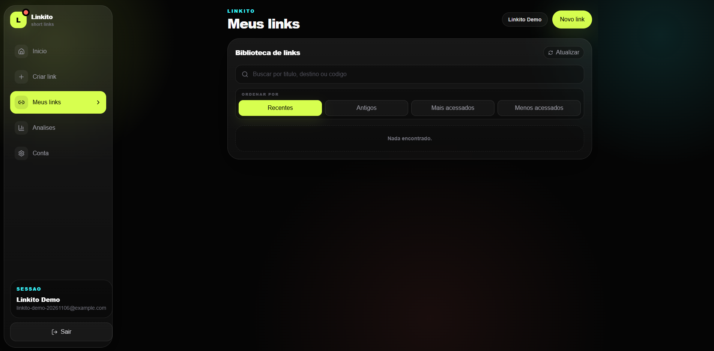
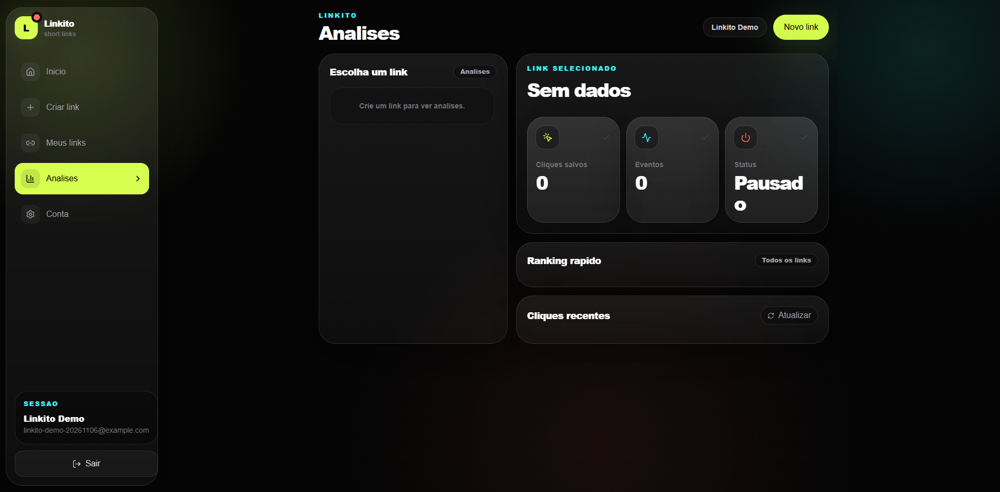
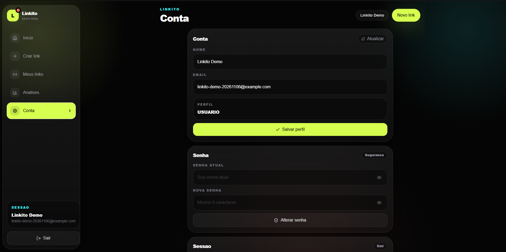

# Linkito


Encurtador full stack para criar, administrar e analisar links curtos. O frontend Next.js consome uma API REST Spring Boot; os dados são persistidos em PostgreSQL e a aplicação roda em containers Docker na AWS.

**Demonstração:** [https://100.58.229.18](https://100.58.229.18/) — endereço IPv4 público atual da EC2, sujeito a mudança se a instância for parada e iniciada novamente.

<p align="center"><a href="docs/assets/dashboard.png"></a></p>

## Telas

<table>
  <tr>
    <td align="center"><strong>Login e cadastro</strong><br><a href="docs/assets/login.png"></a></td>
    <td align="center"><strong>Painel</strong><br><a href="docs/assets/dashboard.png"></a></td>
  </tr>
  <tr>
    <td align="center"><strong>Criar link</strong><br><a href="docs/assets/create-link.png"></a></td>
    <td align="center"><strong>Meus links</strong><br><a href="docs/assets/links.png"></a></td>
  </tr>
  <tr>
    <td align="center"><strong>Análises</strong><br><a href="docs/assets/analytics.png"></a></td>
    <td align="center"><strong>Conta</strong><br><a href="docs/assets/account.png"></a></td>
  </tr>
</table>

## Funcionalidades

- Cadastro e login com senha armazenada em hash BCrypt e autenticação stateless via JWT.
- Criação de URLs curtas com título opcional e código alfanumérico de oito caracteres.
- Listagem por usuário, busca por título/destino/código e ordenação por data ou cliques.
- Pausa, reativação, atualização e exclusão de links.
- Redirecionamento público com resposta HTTP 302 e registro de cliques.
- Painel com contagens gerais, ranking e métricas por link.
- Atualização de perfil e troca de senha.

## Arquitetura e fluxo de dados

```text
Navegador -- HTTPS :443 --> Nginx na EC2
                               ├── /            --> Frontend Next.js (container)
                               ├── /api/*       --> proxy Next.js --> API Spring Boot
                               ├── /r/*         ------------------> API Spring Boot
                               └── /actuator/*  ------------------> API Spring Boot

API Spring Boot -- TCP 5432, rede privada --> Amazon RDS for PostgreSQL
```

1. **Autenticação:** o registro valida os dados e persiste a senha com BCrypt. O login verifica o hash e emite um JWT assinado. O filtro JWT do Spring Security valida o bearer token em cada requisição protegida; a aplicação não mantém sessão HTTP no servidor.
2. **Proxy de API:** o navegador chama a mesma origem HTTPS. O Route Handler `frontend/app/api/[...path]/route.ts` encaminha método, corpo e query string para o backend, usando `BACKEND_URL`. Isso mantém o endereço interno da API fora da interface do navegador e simplifica CORS.
3. **Isolamento por usuário:** os endpoints autenticados extraem o UUID do principal validado pelo filtro. Consultas e alterações de links combinam o ID do recurso com o ID do usuário; conhecer o UUID de outro link não concede acesso a ele.
4. **Persistência:** Spring Data JPA acessa `users`, `short_link` e `link_click`. Flyway versiona o esquema; `ddl-auto=validate` confere o mapeamento da aplicação sem substituir as migrations. O banco impõe unicidade para email e código curto e chaves estrangeiras entre usuários, links e cliques.
5. **Criação e redirecionamento:** o backend gera um código curto e verifica colisões antes de persistir. `GET /r/{codigoCurto}` retorna 404 se o código não existe, 410 se o link está pausado, ou registra o acesso e responde 302 com o destino no cabeçalho `Location`.
6. **Métricas:** o serviço de estatísticas agrega os links do usuário e os eventos associados. A API também verifica a propriedade do link antes de devolver estatísticas individuais.

O Nginx termina TLS com certificado Let's Encrypt e encaminha tráfego localmente para os containers. As portas 3000 e 8080 são vinculadas ao loopback da EC2; o RDS não é público e seu Security Group aceita PostgreSQL somente a partir do grupo da aplicação. O backend e o frontend compartilham a rede Docker `linkito-net`.

## API REST

Base URL da demonstração: `https://100.58.229.18`. Endpoints marcados como **JWT** exigem `Authorization: Bearer <token>`.

| Método | Endpoint | Acesso | Descrição |
|---|---|---|---|
| `POST` | `/api/auth/register` | Público | Cria usuário. |
| `POST` | `/api/auth/login` | Público | Valida credenciais e retorna JWT. |
| `GET` | `/api/auth/me` | JWT | Consulta o perfil autenticado. |
| `PUT` | `/api/auth/me` | JWT | Atualiza nome e email. |
| `PUT` | `/api/auth/password` | JWT | Altera a senha após validar a senha atual. |
| `POST` | `/api/links` | JWT | Cria link curto para o usuário autenticado. |
| `GET` | `/api/links` | JWT | Lista os links do usuário. |
| `GET` | `/api/links/{id}` | JWT | Consulta um link próprio. |
| `PUT` | `/api/links/{id}` | JWT | Atualiza título, destino e/ou estado ativo. |
| `DELETE` | `/api/links/{id}` | JWT | Exclui um link próprio. |
| `GET` | `/api/stats/dashboard` | JWT | Retorna indicadores agregados do painel. |
| `GET` | `/api/stats/links/{id}` | JWT | Retorna estatísticas de um link próprio. |
| `GET` | `/r/{codigoCurto}` | Público | Registra clique e redireciona; 410 para link pausado. |
| `GET` | `/actuator/health` | Público | Health check da API. |

## Tecnologias

### Aplicação e containers

- **Frontend:** Next.js, React, TypeScript, Tailwind CSS e Framer Motion.
- **Backend:** Java 21, Spring Boot 3, Spring Web, Spring Security, Spring Data JPA, Bean Validation e Spring Actuator.
- **Dados e segurança:** PostgreSQL 16, Flyway, JWT, BCrypt, Maven, JUnit e Mockito.
- **Containers:** Docker, Docker Compose e imagens multi-stage. A imagem Java executa como UID não-root `10001`; a imagem Next.js usa saída standalone e usuário não-root.

### AWS, infraestrutura e entrega

- **Amazon EC2:** instância Amazon Linux 2023 executa Nginx e os containers de frontend e backend.
- **Amazon EBS:** volume raiz gp3 criptografado.
- **Amazon RDS for PostgreSQL:** banco Single-AZ em sub-rede privada, armazenamento gp3 criptografado, backup automático e senha master gerenciada pelo Secrets Manager.
- **Amazon VPC:** sub-redes públicas e privadas em duas zonas de disponibilidade, Internet Gateway, tabelas de rotas, Security Groups e endpoint Gateway para S3.
- **Amazon ECR:** repositórios de imagens do frontend e backend, tags imutáveis, verificação de imagens no push e política de retenção.
- **AWS IAM e OIDC:** role de implantação restrita usada pelo GitHub Actions sem credenciais AWS de longa duração armazenadas no repositório.
- **AWS Systems Manager:** Session Manager para administração da EC2 e Run Command para implantação remota.
- **AWS Secrets Manager e AWS KMS:** gerenciamento da senha master do RDS e criptografia de dados em repouso.
- **Amazon CloudWatch:** CloudWatch Logs para logs dos containers e erros do Nginx; CloudWatch Agent e Database Insights/Performance Insights para observabilidade.
- **Amazon S3:** backend remoto do state Terraform, com versionamento, criptografia, bloqueio de acesso público e locking nativo.
- **AWS Budgets:** orçamento mensal de US$ 100 com alertas configurados para acompanhamento de custos.
- **Terraform:** infraestrutura como código para modelar e adotar os recursos AWS existentes. O state principal fica no S3; o plano de reconciliação da infraestrutura existente não recriou nem destruiu recursos.
- **Amazon ECS com AWS Fargate:** cluster e serviço mantidos como base de experimentação no Terraform, com `desired_count = 0`; a aplicação de produção roda na EC2.
- **GitHub Actions:** CI de backend/frontend, build e publicação das imagens no ECR e deploy por OIDC e Systems Manager.
- **Ferramentas de operação:** AWS CLI, Nginx e Certbot/Let's Encrypt.

## Docker e execução local

Na raiz do projeto, o Compose inicia PostgreSQL 16 e backend. O volume nomeado preserva os dados locais:

```bash
docker compose up --build -d
```

- API: `http://localhost:8080`
- Health check: `http://localhost:8080/actuator/health`

Para iniciar o frontend em outro terminal:

```bash
cd frontend
npm ci
npm run dev
```

Frontend: `http://localhost:3000`. Por padrão, seu proxy encaminha `/api/*` para `http://localhost:8080`.

Em produção, o GitHub Actions constrói as duas imagens a partir dos Dockerfiles, publica tags imutáveis no ECR e invoca scripts de deploy via SSM. Os scripts iniciam uma imagem candidata, verificam saúde, trocam o container em execução e recuperam a versão anterior quando a verificação falha.

## Autor

**João Victor** · [GitHub](https://github.com/vavito) · [LinkedIn](https://www.linkedin.com/in/joao-victor-moreira-almeida/)
